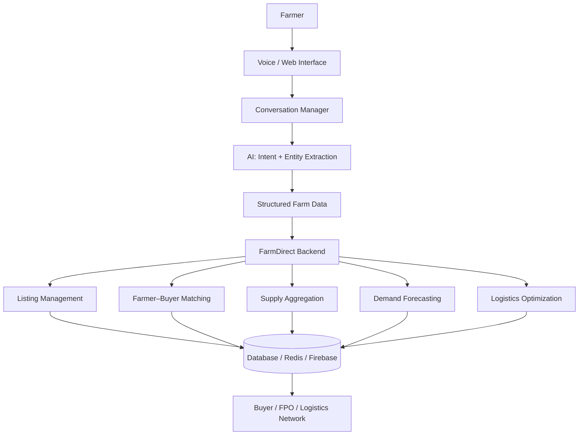
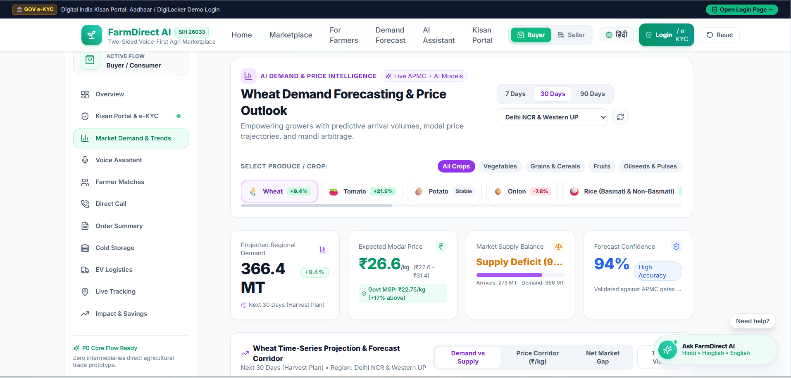

# 🌾 FarmDirect AI

**Kheti se market tak — Your AI-powered agricultural marketplace companion**

> FarmDirect AI is a voice-first coordination platform that connects farmers and FPOs directly with buyers, replacing fragmented intermediary chains with AI-driven matching, aggregation, negotiation, and logistics.

[](https://neural-nomads-prototype.vercel.app/)


---

## 🚨 Problem

Agricultural supply chains in India are weighed down by layers of intermediaries, fragmented demand signals, and poor logistics coordination — all of which squeeze farmer earnings while pushing up prices for consumers.

| Challenge | Impact |
|---|---|
| Multiple intermediaries | Lower farmer earnings |
| Fragmented demand | Unsold or underutilized produce |
| Poor price discovery | Weak negotiation power for farmers |
| Inefficient logistics | Higher transportation costs |
| Digital barriers | Limited marketplace access for farmers |

---

## 💡 Solution

FarmDirect AI is **not just another e-commerce listing platform**. It's an AI-powered coordination layer sitting between farmers, buyers, and logistics — actively matching supply with demand, aggregating fragmented produce into fulfillable orders, and optimizing how goods move from farm to market.

| | Traditional Marketplace | FarmDirect AI |
|---|---|---|
| Role | Passive listing platform | Active AI coordination layer |
| Farmer input | Manual forms | Conversational, voice-first |
| Supply handling | Individual listings | Aggregated across farmers |
| Pricing | Static | AI-assisted negotiation |
| Logistics | Farmer/buyer's problem | Route-optimized coordination |

At the center of the farmer-facing experience is **KisanSaathi** — the conversational AI agent that guides farmers through listing their produce naturally, in their own language.

---

## ✨ Key Features

- 🎙️ **Voice-First Farmer Experience** — natural conversation in Hindi, Hinglish, or English
- 📝 **AI-Powered Listing Creation** — structured data from unstructured speech
- 🤝 **Farmer–Buyer Matching** — `matchFarmers()` / `matchBuyers()`
- 📦 **Supply Aggregation** — `aggregateSupply()` combines nearby farmer supply to meet bulk demand
- 💬 **AI-Assisted Negotiation** — `suggestNegotiation()` helps reach fair price agreements
- 📈 **Demand Forecasting** — anticipates upcoming demand to guide selling decisions
- 🚚 **Route Optimization** — `optimizeRoute()` coordinates efficient produce movement
- 🏬 **Virtual Collection Centers (VCC)** — consolidation points before transport
- 🔄 **Dynamic Reverse Logistics** — better utilization of return trips
- 🧠 **Conversation State Management** — one question at a time, always
- ✏️ **Correction & Confirmation Flow** — farmers can fix details before finalizing

---

## 🎙️ Voice-First Experience

KisanSaathi collects listing information conversationally instead of relying on complex forms — asking one question at a time, filling slots as the farmer responds naturally.

```
AI: Namaste ji! FarmDirect se bol raha hoon. Kya bechna chahte hain?
Farmer: Aalu
AI: Achha ji. Kitna maal hai?
Farmer: 500 kilo
AI: Theek hai. Aapka rate kya hoga?
Farmer: 15 rupaye kilo
AI: Samajh gaya. Ek baar confirm kar lete hain...
```

This flow relies on a few core principles:

- **Multilingual interaction** — Hindi, Hinglish, and English handled fluidly
- **One question at a time** — no overwhelming multi-field forms
- **Slot filling** — each answer populates a structured field (product, quantity, price, location, etc.)
- **State management** — the agent always knows what's been captured and what's next
- **Correction handling** — farmers can revise any detail before submission
- **Confirmation** — a final recap ensures accuracy before the listing goes live

---

## 🧠 AI Capabilities

| Capability | Function |
|---|---|
| Farmer Matching | `matchFarmers()` |
| Buyer Matching | `matchBuyers()` |
| Supply Aggregation | `aggregateSupply()` |
| Negotiation Assistance | `suggestNegotiation()` |
| Route Optimization | `optimizeRoute()` |
| Demand Forecasting | Predicts upcoming demand to inform farmer/FPO decisions |

---

## 🏗️ System Architecture



---

## 🔄 How It Works

1. Farmer starts a conversation (voice or text)
2. AI identifies intent (sell, check price, view orders, etc.)
3. AI collects product details conversationally
4. AI validates the information as it's gathered
5. Farmer confirms or corrects details
6. A structured listing is generated
7. The listing enters the FarmDirect ecosystem
8. Buyers are matched against the listing
9. Compatible supply is aggregated where needed
10. Logistics are optimized for the resulting order

---

## 🧩 Technical Architecture

| Layer | Technologies |
|---|---|
| Frontend | React / Next.js, TypeScript, Tailwind CSS, Lucide Icons, Recharts |
| Backend | Node.js, FastAPI (where applicable) |
| Database | PostgreSQL, Firebase / Firestore |
| Messaging | Redis Pub/Sub |
| AI | Conversational AI, voice processing, RAG (where applicable), demand forecasting, intelligent matching, route optimization |
| Deployment | Vercel / cloud deployment (where applicable) |

---

## 🗂️ Project Structure

```text
FarmDirect-AI/
├── frontend/
│   ├── components/
│   ├── pages/
│   ├── services/
│   └── styles/
├── backend/
│   ├── ai/
│   ├── matching/
│   ├── logistics/
│   └── api/
├── server/
├── public/
├── assets/
└── README.md
```

> If the actual repository structure differs, replace this with the real layout.

---

## 🔐 Data & Validation

Every listing is validated before it enters the marketplace. Fields captured and checked include:

- Farmer name
- Phone number
- Product
- Quantity and unit
- Location
- Quality
- Asking price and price unit
- Intent
- Source

No real personal phone numbers or credentials are stored in this repository or exposed in the app's example data.

---

## 🧪 Conversation Flow

```text
IDLE
 ↓
LISTENING
 ↓
PRODUCT_CAPTURED
 ↓
QUANTITY_CAPTURED
 ↓
LOCATION_CAPTURED
 ↓
QUALITY_CAPTURED
 ↓
PRICE_CAPTURED
 ↓
PHONE_CAPTURED
 ↓
CONFIRMATION
 ↓
SUCCESS
```

Explicit state management keeps the conversation reliable — the agent always knows exactly what's been captured, what's missing, and what to ask next, even across corrections or interruptions.

---

## 📊 Impact

FarmDirect AI is designed to move the needle on:

- Improved market access for farmers, without requiring digital literacy
- Reduced dependency on intermediary chains
- Better price discovery through AI-assisted negotiation
- Coordinated supply through aggregation across farmers
- Improved logistics utilization via route and reverse-logistics optimization
- Easier digital participation for farmers who are more comfortable speaking than typing

---

## 🛠️ Tech Stack

| Technology | Purpose |
|---|---|
| React / Next.js | Frontend framework |
| TypeScript | Type-safe application logic |
| Tailwind CSS | Styling |
| Lucide Icons | Iconography |
| Recharts | Data visualization / dashboards |
| Node.js | Backend runtime |
| FastAPI | Backend services (where applicable) |
| PostgreSQL | Relational data storage |
| Firebase / Firestore | Real-time / auxiliary data storage |
| Redis Pub/Sub | Messaging and event coordination |

---

## 🚀 Getting Started

### Prerequisites

- Node.js (LTS recommended)
- npm or yarn
- PostgreSQL instance (if running the full backend)
- Firebase project credentials (if using Firestore features)

### Clone

```bash
git clone <repository-url>
cd <repository-name>
```

### Install dependencies

```bash
npm install
```

### Environment Variables

Create a `.env.example` file (never commit real secrets):

```env
# Database
DATABASE_URL=
FIREBASE_API_KEY=

# Redis
REDIS_URL=

# AI Service
AI_SERVICE_API_KEY=
```

### Run locally

```bash
# Frontend
npm run dev

# Backend
npm run start:server
```

---

## 🧪 Testing

```bash
npm run test
```

If conversation-manager tests are present, they should cover slot-filling accuracy, state transitions, and correction handling. Test coverage details will be added as the suite matures.

---

## 🔌 API / Data Flow

The listing creation flow moves from voice/text input → intent & entity extraction → structured data → validation → listing creation, without exposing any credentials or personal data in transit or storage. Detailed endpoint documentation will be added as the API surface stabilizes.

---

## 🧠 Design Decisions

- **Why voice-first?** Many farmers are more comfortable speaking than filling digital forms — voice removes the literacy and UI-familiarity barrier.
- **Why conversational slot filling?** It breaks a complex listing form into a natural, low-friction dialogue.
- **Why one question at a time?** Reduces cognitive load and mirrors how a real conversation with a market agent would flow.
- **Why conversation state?** Ensures the agent can handle interruptions, corrections, and multi-turn dialogue reliably.
- **Why correction handling?** Farmers should be able to fix a misheard or mistaken detail without restarting the whole flow.
- **Why supply aggregation?** Individual farmer supply is often too small to meet bulk buyer demand — aggregation unlocks larger deals.
- **Why logistics optimization?** Uncoordinated transport is a major source of inefficiency and cost in agricultural supply chains.

---

## 🔮 Future Roadmap

> The following are roadmap ideas, not current features.

- Regional language expansion beyond Hindi/Hinglish/English
- Smarter, ML-driven demand forecasting
- Personalized buyer recommendations
- Logistics marketplace integration
- Market price intelligence tools
- FPO-specific dashboards
- Offline / low-connectivity support

---

## 🤝 Contributing

Contributions are welcome!

1. Fork the repository
2. Create a feature branch (`git checkout -b feature/your-feature`)
3. Commit your changes (`git commit -m 'Add your feature'`)
4. Push to the branch (`git push origin feature/your-feature`)
5. Open a Pull Request

---

## 📄 License

> License information will be added soon.

---

## 👥 Team

_Team member details to be added._

---

## 🏆 Hackathon Context

FarmDirect AI was developed around Smart India Hackathon problem statement **26033**, addressing intermediary dependency and coordination gaps in agricultural supply chains.

---

## 📸 Screenshots / Demo

```markdown




```

---

## 🌐 Demo

```text
Demo: Coming soon
```

---

## ⭐ Why FarmDirect AI

FarmDirect AI is not just about putting farmers online. It's about using AI to coordinate the fragmented journey from farm → aggregation → buyer → logistics → market.
